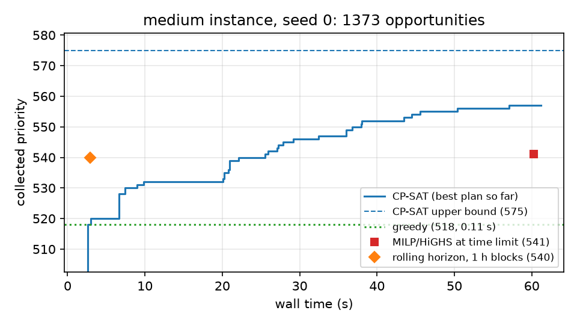
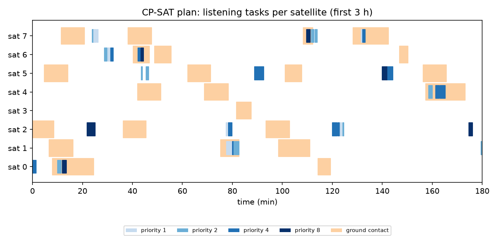
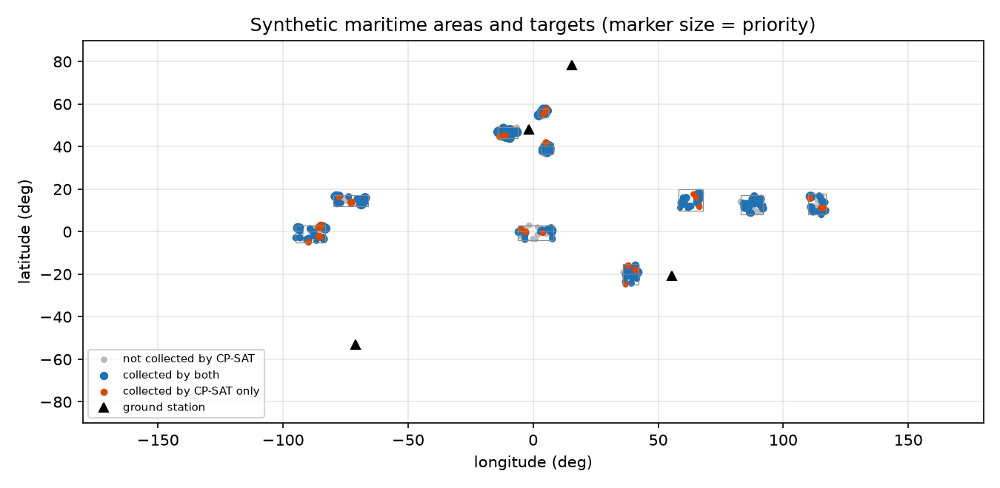

# Satellite pass planning with CP-SAT

A small, self-contained study of **planning listening tasks for a constellation of
radio-frequency (RF) monitoring satellites**: which maritime targets each satellite should
listen to, on which pass, and when, under reconfiguration, power and memory constraints.

The same problem is solved four ways and compared on quality, proven bound and solve time:

1. a **greedy** heuristic (highest priority per second first, earliest feasible insertion);
2. a **constraint-programming model** solved with OR-Tools **CP-SAT**, on the whole horizon;
3. a **rolling-horizon decomposition**: the same CP-SAT model solved one hour at a time;
4. a **mixed-integer linear program** (big-M disjunctions) solved with **HiGHS** through SciPy.

Every plan from every method goes through an independent checker (`satplan/checker.py`).

> Everything here is synthetic and simplified: circular orbits, spherical Earth, generic
> ocean areas, illustrative ground stations and budgets. It is a modelling exercise, not an
> operator's tool or data.

## Problem

| Element | Model |
| --- | --- |
| Constellation | Circular sun-synchronous orbits at 550 km (97.6°), several planes, Earth rotation; no J2 |
| Targets | Points in 10 generic maritime areas; priority 1, 2, 4 or 8; required listening time 30–120 s |
| Opportunity | (satellite, target, visibility window): off-nadir ≤ 55° and elevation ≥ 10°, 10 s time grid |
| Collection | Each target at most once; objective = total priority collected |
| Task placement | A task of length d<sub>j</sub> fits entirely inside its window |
| Reconfiguration | Tasks on one satellite do not overlap and are separated by s(a, b) = 10 s + angle(a, b) / (2°/s), with the pointing angle taken at window midpoints (sequence-dependent setup time) |
| Power | ≤ 300 s of listening per satellite and orbital revolution |
| Memory | ≤ 600 s of recording between two ground-station contacts (each contact empties the memory) |

Revolution and memory segments are assigned from the window midpoint, so each opportunity
belongs to exactly one segment of each kind.

### CP-SAT model (`satplan/cpsat.py`)

* one Boolean `x_o` and one integer start `s_o ∈ [window start, window end − d]` per opportunity,
  tied together in an **optional fixed-size interval**;
* `AddAtMostOne` over the opportunities of each target;
* `AddNoOverlap` over each satellite's intervals (redundant, but strong global propagation);
* for each pair of opportunities on the same satellite whose placements can interfere
  (found by a sweep over sorted windows, `instance.build_pairs`):
  * neither order fits → `x_a ∧ x_b` forbidden;
  * only one order fits → `s_b ≥ s_a + d_a + s(a, b)` enforced if both are selected;
  * both orders fit → an order literal and two enforced precedences;
* linear knapsack constraints for the power and memory budgets;
* the greedy plan is given as a **solution hint**.

### MILP model (`satplan/milp.py`)

Same variables with continuous start times and an order binary per two-way pair. Each
disjunction uses the smallest big-M that deactivates it given the start-time bounds.

### Rolling horizon (`satplan/rolling.py`)

Opportunities are grouped by the hour in which their window starts. Each block is solved
with the CP-SAT model above; tasks chosen in earlier blocks are fixed, their targets are
removed, the budgets they used are carried over, and new tasks must keep the
reconfiguration times with fixed tasks on the same satellite. The time limit is split evenly
between blocks. It gives no bound and can be myopic at block borders.

## Results

Full table, solve times and memory sweep: [`results/results.md`](results/results.md), generated by
`scripts/run_benchmark.py` (8 instances, 3 sizes; same time limit for every exact method;
CP-SAT with 8 threads, HiGHS single-threaded). Gap = distance to the best upper bound proven
by CP-SAT or HiGHS, so it overstates the distance to the true optimum on medium and large
instances.

| size (per instance) | time limit | greedy | CP-SAT, whole horizon | rolling CP-SAT, 1 h blocks | MILP (HiGHS) |
| --- | --- | --- | --- | --- | --- |
| small: 4 sats, 120 targets, 6 h, ~170 opportunities, ~950 pairs | 20 s | 10–12 % below optimum, 0.01 s | **optimal, proven in 0.6–1.8 s** | 0.5–2.0 % below, 0.1–0.3 s | optimal, proven in 9–17 s |
| medium: 8 sats, 250 targets, 12 h, ~1,350 opp., ~15,500 pairs | 60 s | gap 7–10 % | **gap 2.3–3.1 %** | gap 5.3–6.1 %, in 1.4–3.6 s | gap 4.0–8.3 % |
| large: 12 sats, 600 targets, 12 h, ~4,900 opp., ~140,000 pairs | 120 s | gap 6.9–7.0 % | gap 5.3–5.8 % | **gap 4.2–4.4 %, in 57–77 s** | gap 21–87 % |



What the numbers say:

* **Exact methods agree.** On the small instances, CP-SAT and the MILP are independent
  formulations and prove the same optimum; CP-SAT does it 10 to 16 times faster.
* **The solver earns its keep.** Greedy, the kind of rule a first planning tool uses, leaves
  10–12 % of the achievable priority on the table on small instances. CP-SAT closes all of it.
* **Formulation matters more than the solver at scale.** The big-M MILP has a weak linear
  relaxation and up to two constraints per conflicting pair; at 140,000 pairs HiGHS stalls and
  returns plans worse than greedy. CP-SAT reasons on intervals and precedences directly.
* **Decomposition wins on large instances.** On the whole 12-hour horizon, CP-SAT gains only
  1–2 % over greedy in 120 s. Solving one hour at a time gives the best plans in less
  time. On medium instances the opposite holds: the whole-horizon model is better, and the
  rolling horizon is a fast (2–4 s) fallback.
* **Which constraint binds.** At 300 s of memory between contacts or less, memory limits
  collection (489 at 200 s, proven optimal); above 450 s, the value stays at 549–554
  whatever the memory, so reconfiguration times and the power budget are what limit it. The
  small non-monotonic changes (553, 549, 554) are run-to-run noise of a multi-threaded
  search stopped at a time limit, not an effect of the budget.





Also tried, not kept: a redundant capacity constraint per pass (sum of durations plus
settle times ≤ pass length) tightened the medium bound only from 575 to 573 in one 30 s run,
and removing `NoOverlap` changed the value by about as much as run-to-run noise.

## Limitations

* Synthetic, simplified scenario (see the problem table); no claim about any real system.
* Reconfiguration time uses pointing directions at window midpoints, fixed per pair; budget
  segments are assigned from window midpoints; each ground contact empties the memory.
* Static plan over a fixed horizon: no new requests, no replanning, no uncertainty on
  detections or on the emitters' activity.
* On medium and large instances the true optimum is unknown; gaps are upper estimates.

## Next steps

* Seed the whole-horizon CP-SAT with the rolling-horizon plan, then polish it.
* Overlapping blocks, or large neighbourhood search by satellite or by maritime area.
* Stronger bounds (Lagrangian relaxation of the one-collection-per-target constraints).
* Replanning: insert urgent requests into a running plan with minimal changes.

## Reproduce

```bash
python -m venv .venv
.venv/Scripts/python -m pip install -r requirements.txt   # Linux/macOS: .venv/bin/python
.venv/Scripts/python -m pytest                            # 14 tests, about 35 s
.venv/Scripts/python scripts/run_benchmark.py             # about 20 min; --quick for a 1-min smoke run
```

## Tests

* geometry: orbital period and radius, maximum latitude of the ground track, a point under the
  satellite is visible and its antipode is not;
* hand-made two-task instances where the answer is known (transition makes tasks exclusive,
  small angle allows both, power budget binds);
* the checker catches out-of-window starts, missing transitions, budget overruns and double
  collection;
* the pair sweep skips only pairs that cannot interfere (checked by brute force over all pairs);
* on three generated instances of about 170 opportunities, CP-SAT and the MILP both prove
  optimality and find the **same optimum**, greedy is never better, and all plans pass the checker;
* the rolling horizon returns a feasible plan at least as good as greedy.

## Layout

```
satplan/geometry.py   orbits, ground points, visibility masks
satplan/scenario.py   synthetic constellation, maritime areas, ground stations, windows
satplan/instance.py   opportunities, transition times, conflict pairs, budgets
satplan/checker.py    independent feasibility check
satplan/greedy.py     greedy baseline
satplan/cpsat.py      CP-SAT model
satplan/milp.py       MILP model (HiGHS via SciPy)
satplan/rolling.py    rolling-horizon CP-SAT
scripts/run_benchmark.py   benchmark, figures, results/results.md
tests/                pytest suite
```
