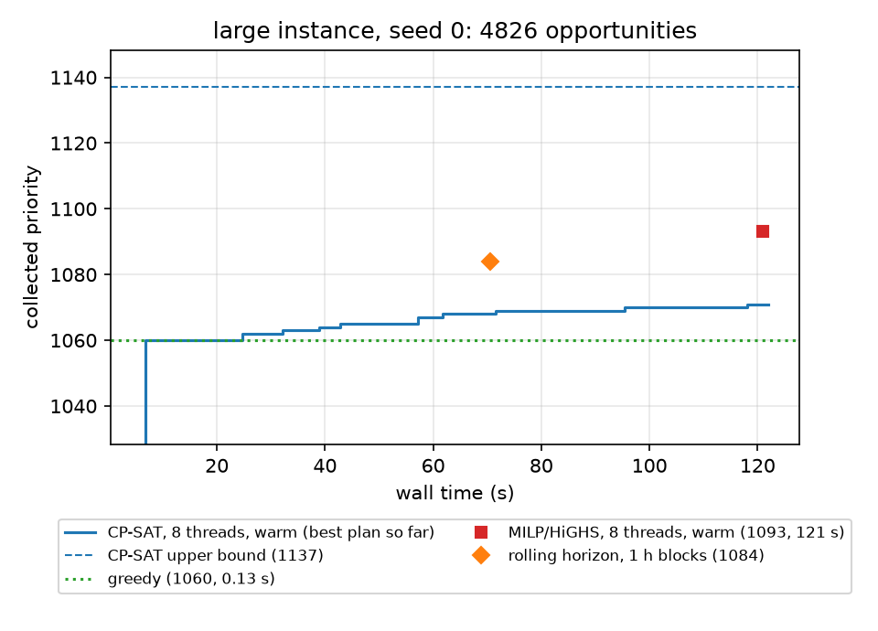

# Satellite pass planning: CP-SAT, MILP and greedy

A small, self-contained study of **planning listening tasks for a constellation of
radio-frequency (RF) monitoring satellites**: which maritime targets each satellite should
listen to, on which pass, and when, under reconfiguration, power and memory constraints.

The same problem is solved four ways and compared on quality, proven bound and solve time:

1. a **greedy** heuristic (highest priority per second first, earliest feasible insertion);
2. a **constraint-programming model** solved with OR-Tools **CP-SAT**, on the whole horizon;
3. a **rolling-horizon decomposition**: the same CP-SAT model solved one hour at a time;
4. a **mixed-integer linear program** (big-M disjunctions) solved with **HiGHS** (`highspy`).

The two exact solvers are compared in two matched settings, so that neither gets more help
than the other: **one thread and no starting solution**, and **eight threads, both started
from the greedy plan**.

Every plan from every method goes through a checker (`satplan/checker.py`) that does not
reuse the solver models: it re-checks every pair of tasks on a satellite and rebuilds the
budget sums.

> Everything here is synthetic and simplified: circular orbits, spherical Earth, generic
> ocean areas, illustrative ground stations and budgets. It is a modelling exercise, not an
> operator's tool or data.

## Problem

| Element | Model |
| --- | --- |
| Constellation | Circular orbits at 550 km with the sun-synchronous inclination (97.6°), several planes, Earth rotation; no J2, so the planes do not precess (negligible over 12 h) |
| Targets | Points in 10 generic maritime areas; priority 1, 2, 4 or 8; required listening time 30–120 s |
| Opportunity | (satellite, target, visibility window): off-nadir ≤ 55° and elevation ≥ 10°, 10 s time grid. At 550 km, 55° off-nadir already means about 27° elevation, so the off-nadir limit is the one that binds |
| Collection | Each target at most once; objective = total priority collected |
| Task placement | A task of length d<sub>j</sub> fits entirely inside its window |
| Reconfiguration | Tasks on one satellite do not overlap and are separated by s(a, b) = 10 s + angle(a, b) / (2°/s), with the pointing angle taken at window midpoints (sequence-dependent setup time) |
| Power | ≤ 300 s of listening per satellite and orbital revolution |
| Memory | ≤ 600 s of recording between two ground-station contacts (each contact empties the memory) |

Revolution and memory segments are assigned from the window midpoint, so each opportunity
belongs to exactly one segment of each kind.

### CP-SAT model (`satplan/cpsat.py`)

* one Boolean `x_o` and one integer start `s_o ∈ [window start, window end − d]` per opportunity,
  tied together in an **optional fixed-size interval**;
* `AddAtMostOne` over the opportunities of each target;
* `AddNoOverlap` over each satellite's intervals (redundant, but strong global propagation);
* for each pair of opportunities on the same satellite whose placements can interfere
  (found by a sweep over sorted windows, `instance.build_pairs`):
  * neither order fits → `x_a ∧ x_b` forbidden;
  * only one order fits → `s_b ≥ s_a + d_a + s(a, b)` enforced if both are selected;
  * both orders fit → an order literal and two enforced precedences;
* linear knapsack constraints for the power and memory budgets;
* in the warm setting, the greedy plan is given as a **solution hint**.

### MILP model (`satplan/milp.py`)

Same variables with continuous start times and an order binary per two-way pair. Each
disjunction uses the smallest big-M that deactivates it given the start-time bounds. Solved
with HiGHS through `highspy`, which exposes the thread count and a MIP start (SciPy's
`milp` exposes neither); in the warm setting the greedy plan is passed as the MIP start.
Both solvers stop only at a proven optimum (relative gap 0) or at the time limit.

Pairwise reconfiguration constraints are exact here, not only between consecutive tasks:
the transition time obeys the triangle inequality (it is built from an angle), so a task
that respects its neighbours also respects every later task.

### Rolling horizon (`satplan/rolling.py`)

Opportunities are grouped by the hour in which their window starts. Each block is solved
with the CP-SAT model above; tasks chosen in earlier blocks are fixed, their targets are
removed, the budgets they used are carried over, and new tasks must keep the
reconfiguration times with fixed tasks on the same satellite. The time limit is split evenly
between blocks. It gives no bound and can be myopic at block borders.

## Results

Full table with every run, times and the memory sweep: [`results/results.md`](results/results.md),
generated by `scripts/run_benchmark.py` (8 instances, 3 sizes, same time limit for every
method). Gap = distance to the best upper bound proven by any exact run, so on medium and
large instances it overstates the distance to the true optimum. Ranges are over seeds.

| size (per instance) | limit | greedy | CP-SAT 1 thread, cold | MILP 1 thread, cold | CP-SAT 8 threads, warm | MILP 8 threads, warm | rolling CP-SAT, 1 h blocks |
| --- | --- | --- | --- | --- | --- | --- | --- |
| small: 4 sats, 120 targets, 6 h, ~170 opp., ~950 pairs | 20 s | 10–12 % below optimum | optimum proven on 2 of 3, 3.8–9.1 s (third: 0.6 % gap at 20 s) | optimum proven on 3 of 3, 4.8–6.3 s | **optimum proven on 3 of 3, 0.6–0.9 s** | optimum proven on 3 of 3, 4.4–11.7 s | 0.5–1.5 % below, 0.1–0.2 s |
| medium: 8 sats, 250 targets, 12 h, ~1,350 opp., ~15,500 pairs | 60 s | gap 7.3–9.9 % | gap 13.6–18.4 % (worse than greedy) | gap 2.3–4.2 % | **gap 2.3–3.5 %** | gap 2.3–3.7 % | gap 4.5–6.3 %, in 1.7–3.2 s |
| large: 12 sats, 600 targets, 12 h, ~4,900 opp., ~140,000 pairs | 120 s | gap 6.8–7.0 % | gap 42–64 % | gap 4.2–4.5 % | gap 5.4–5.8 % | **gap 3.9–4.2 %** | gap 4.7–4.8 %, in 67–71 s |



What the numbers say:

* **Exact methods agree.** On the small instances, CP-SAT and the MILP are different
  formulations and prove the same optimum; the checker accepts both plans.
* **Greedy's shortfall shrinks with size.** The best method collects 11–13 % more
  priority than greedy on small instances (the proven optimum), 5–7 % more on medium ones and
  3 % more on large ones.
* **Parallelism is CP-SAT's edge, not the model.** With one thread and no start, HiGHS is
  as fast as CP-SAT on small instances and more reliable, and CP-SAT falls below greedy on
  medium and large ones. CP-SAT's 8-thread portfolio changes this: it proves the small optima
  in under a second. HiGHS's MIP search gains little from extra threads here (its 8-thread warm runs
  were no faster than its 1-thread cold ones), so on the same 8-thread machine CP-SAT proves small
  optima about 7× faster than HiGHS's best run (0.6–0.9 s against 4.4–6.3 s).
* **At scale the MILP holds up.** With HiGHS 1.16 the big-M MILP gives the best plans on the
  large instances, even on one thread without a start. An earlier version of this benchmark
  ran HiGHS through SciPy and saw the MILP stall on large instances (plans below greedy);
  with `highspy` 1.16 it does not. I have not isolated the cause, so no claim is made about
  formulations in general from that earlier run.
* **Decomposition is a cheap second best on large instances.** Solving one hour at a time
  beats whole-horizon CP-SAT and comes within about 1 point of the MILP in roughly 60 % of
  the time. On medium instances it is worse than either exact solver, but takes 2–3 s.
* **Which constraint binds.** At 300 s of memory between contacts or less, memory limits
  collection (489 at 200 s, proven optimal); above 450 s, the value stays at 545–552
  whatever the memory, so reconfiguration times and the power budget are what limit it. The
  small non-monotonic changes are run-to-run noise of a multi-threaded search stopped at a
  time limit, not an effect of the budget.


Also tried, not kept: a redundant capacity constraint per pass (sum of durations plus
settle times ≤ pass length) tightened the medium bound only from 575 to 573 in one 30 s run,
and removing `NoOverlap` changed the value by about as much as run-to-run noise.

## Limitations

* Synthetic, simplified scenario (see the problem table); no claim about any real system.
* Reconfiguration time uses pointing directions at window midpoints, fixed per pair; budget
  segments are assigned from window midpoints; each ground contact empties the memory.
* Static plan over a fixed horizon: no new requests, no replanning, no uncertainty on
  detections or on the emitters' activity.
* On medium and large instances the true optimum is unknown; gaps are upper estimates.
* Two or three seeds per size, one run each; multi-threaded results vary between runs.

## Next steps

* Seed the whole-horizon CP-SAT or the MILP with the rolling-horizon plan, then polish it.
* Find why HiGHS through SciPy stalled on the large instances where `highspy` 1.16 did not.
* Overlapping blocks, or large neighbourhood search by satellite or by maritime area.
* Stronger bounds (Lagrangian relaxation of the one-collection-per-target constraints).
* Replanning: insert urgent requests into a running plan with minimal changes.

## Reproduce

```bash
python -m venv .venv
.venv/Scripts/python -m pip install -r requirements.txt   # Linux/macOS: .venv/bin/python
.venv/Scripts/python -m pytest                            # 16 tests, about 1 min
.venv/Scripts/python scripts/run_benchmark.py             # about 45 min; --quick for a 2-min smoke run
```

## Tests

* geometry: orbital period and radius, maximum latitude of the ground track, a point under the
  satellite is visible and its antipode is not;
* hand-made two-task instances where the answer is known (transition makes tasks exclusive,
  small angle allows both, power budget binds);
* the checker catches out-of-window starts, missing transitions, budget overruns and double
  collection;
* the pair sweep skips only pairs that cannot interfere (checked by brute force over all pairs);
* on three generated instances of about 170 opportunities, CP-SAT and the MILP both prove
  optimality and find the **same optimum**, greedy is never better, and all plans pass the checker;
* the rolling horizon returns a feasible plan at least as good as greedy;
* the greedy plan, turned into a MILP start, satisfies every MILP row and bound with the
  same objective; the MILP with 4 threads and that start reaches the same optimum as the
  one-thread cold run.

## Layout

```
satplan/geometry.py   orbits, ground points, visibility masks
satplan/scenario.py   synthetic constellation, maritime areas, ground stations, windows
satplan/instance.py   opportunities, transition times, conflict pairs, budgets
satplan/checker.py    feasibility check, independent of the solver models
satplan/greedy.py     greedy baseline
satplan/cpsat.py      CP-SAT model
satplan/milp.py       MILP model (HiGHS via highspy)
satplan/rolling.py    rolling-horizon CP-SAT
scripts/run_benchmark.py   benchmark, figures, results/results.md
tests/                pytest suite
```
